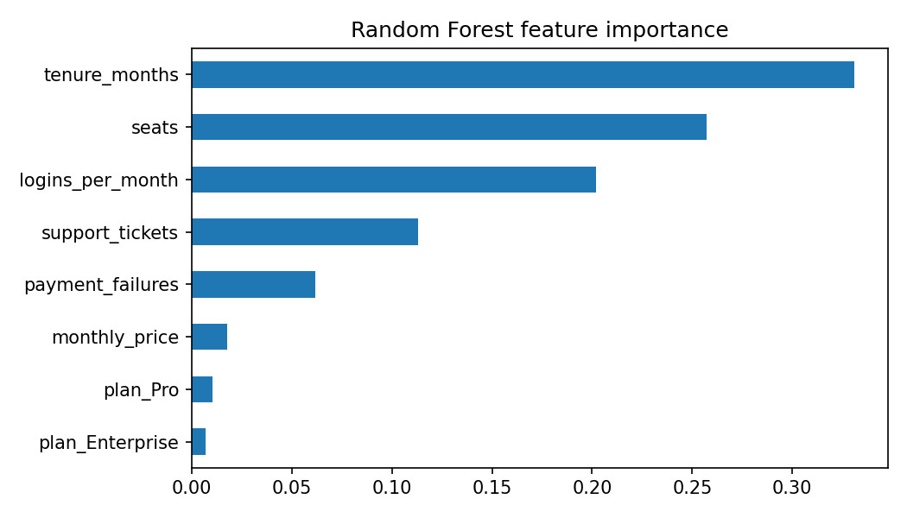

# SaaS Churn Prediction

A machine learning project that predicts which SaaS subscribers are likely to cancel, comparing three classification models and saving the best one for reuse.

> **Note:** This project uses a **synthetic dataset** generated in the script. Results demonstrate the modeling workflow, not real customer behavior.

## Business Problem

Subscription businesses lose revenue when customers cancel. If a company can identify at-risk subscribers early, it can step in with support, discounts, or outreach. This project builds and compares models that flag likely churners from usage, billing, and support signals.

## Dataset

5,000 synthetic subscribers (about 26% churn rate), saved as `saas_subscribers.csv`.

| Feature | Description |
|---|---|
| `tenure_months` | How long the customer has subscribed |
| `plan` | Basic, Pro, or Enterprise |
| `monthly_price` | Price tied to the plan |
| `logins_per_month` | Product usage |
| `support_tickets` | Tickets opened |
| `payment_failures` | Failed payment attempts |
| `seats` | Number of user seats |
| `churned` | Target: 1 = cancelled, 0 = retained |

## Approach

1. Generate the dataset with realistic churn drivers (low usage, payment failures, and short tenure raise churn risk)
2. One-hot encode the plan, then split 80/20 with stratification
3. Train Logistic Regression (with scaling), Random Forest, and XGBoost
4. Compare models on accuracy, precision, recall, F1, and ROC-AUC
5. Save the best model by ROC-AUC with `joblib`
6. Plot feature importance

## Results

| Model | Accuracy | Precision | Recall | F1 | ROC-AUC |
|---|---|---|---|---|---|
| Logistic Regression | 0.760 | 0.583 | 0.284 | 0.381 | **0.750** |
| Random Forest | 0.731 | 0.476 | 0.299 | 0.367 | 0.690 |
| XGBoost | 0.760 | 0.576 | 0.307 | 0.400 | 0.713 |

**Logistic Regression performed best by ROC-AUC.** The synthetic churn signal is mostly linear, so a simple model beats the more complex tree-based ones here.

**Limitation:** Recall is about 0.3, so the models miss roughly 70% of churners at the default 0.5 threshold. See the improvements below.



## Tech Stack

Python, pandas, NumPy, scikit-learn, XGBoost, Matplotlib, joblib

## Getting Started

```bash
git clone https://github.com/hoomanv3xo/saas-churn-prediction.git
cd saas-churn-prediction
pip install -r requirements.txt
python churn_prediction.py
```

The script creates `saas_subscribers.csv`, `model_comparison.csv`, `best_churn_model.joblib`, and `feature_importance.png`.

### Using the saved model

```python
import joblib
import pandas as pd

saved = joblib.load("best_churn_model.joblib")
model, columns = saved["model"], saved["columns"]

new_customer = pd.DataFrame([{
    "tenure_months": 3, "monthly_price": 15, "logins_per_month": 2,
    "support_tickets": 4, "payment_failures": 2, "seats": 1,
    "plan_Pro": 0, "plan_Enterprise": 0,
}])[columns]

print(model.predict_proba(new_customer)[:, 1])  # churn probability
```

## Project Structure

```
saas-churn-prediction/
├── churn_prediction.py       # Data generation, training, evaluation
├── saas_subscribers.csv      # Synthetic dataset
├── model_comparison.csv      # Metrics for all models
├── best_churn_model.joblib   # Saved best model
├── feature_importance.png    # Feature importance chart
├── requirements.txt
└── README.md
```

## Next Steps

- Lower the decision threshold or use `class_weight="balanced"` to improve recall
- Add cross-validation and hyperparameter tuning
- Rerun on a real dataset such as the Telco Customer Churn dataset
- Wrap the model in a Streamlit app so non-technical users can score customers

## Author

**Hooman Vahdat**
[GitHub](https://github.com/hoomanv3xo)
